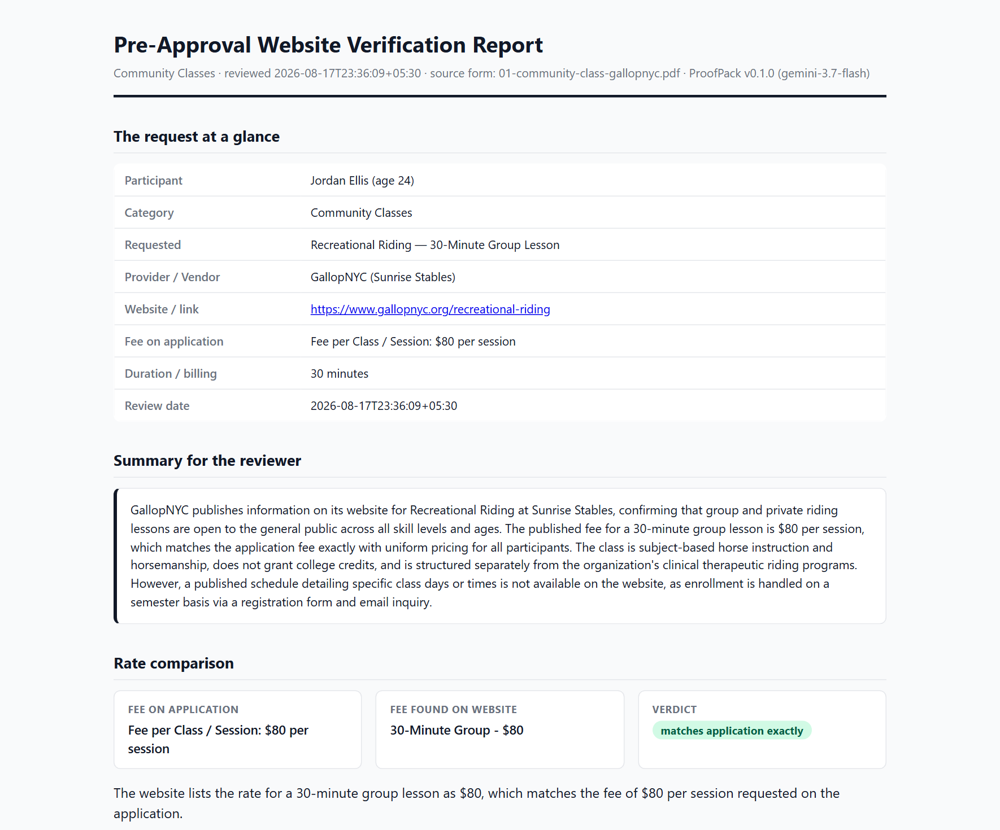
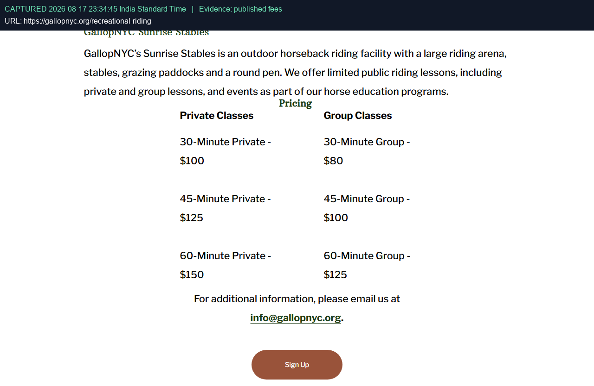
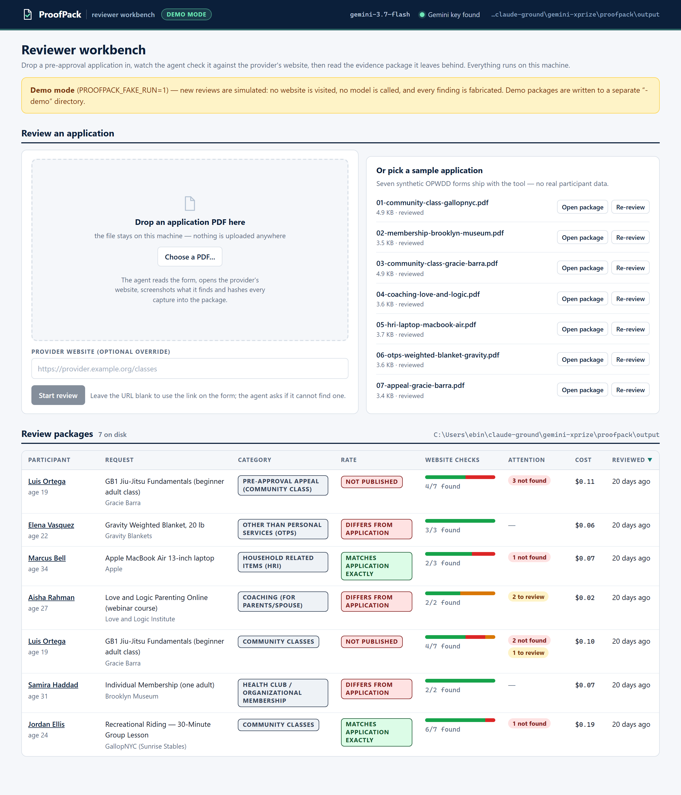
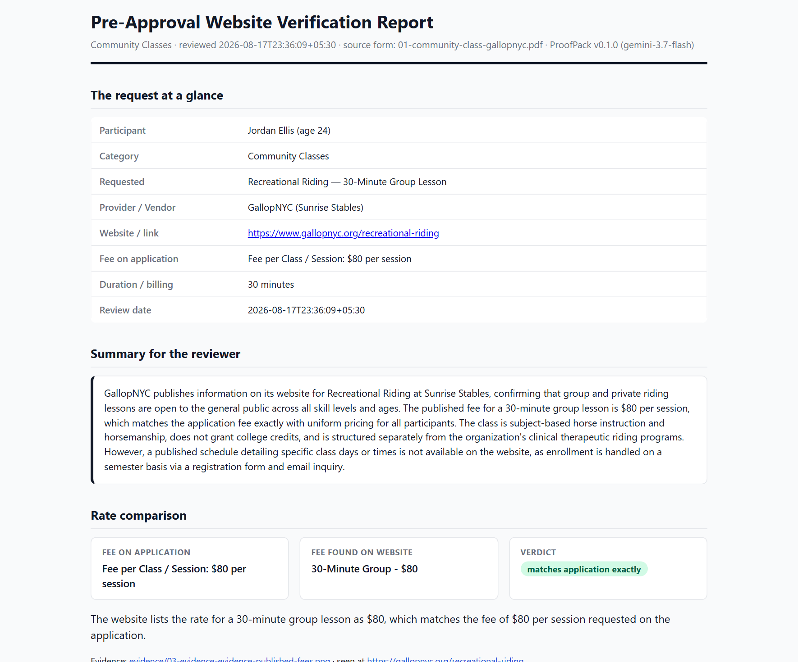
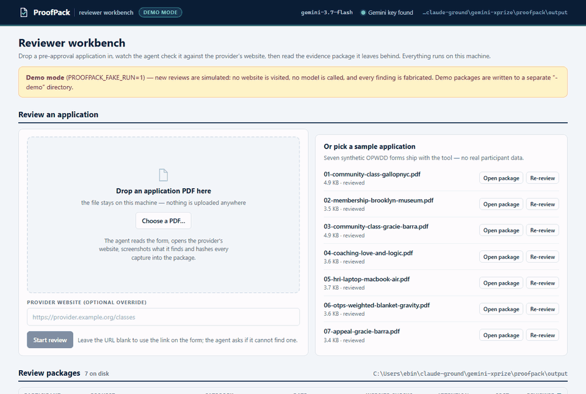
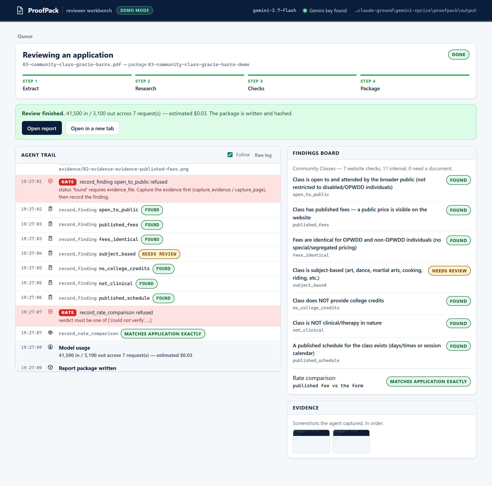
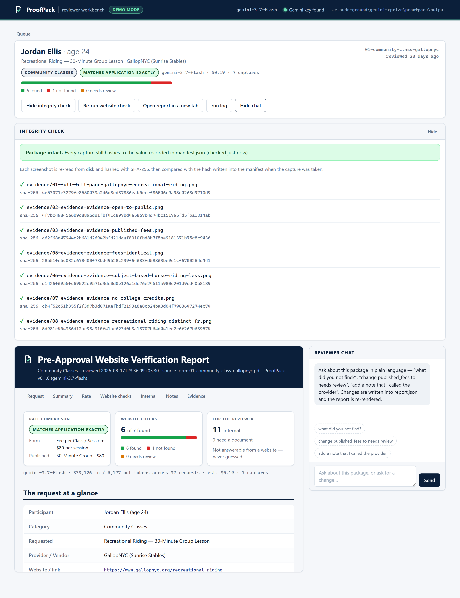

# ProofPack

[](https://github.com/ebt55/proofpack/actions/workflows/tests.yml)
[](LICENSE)
[](requirements.txt)
[](https://ai.google.dev/)

ProofPack is an AI agent that does a compliance reviewer's website research and keeps the
evidence. It is built for the staff who approve purchases from self-directed Medicaid budgets.
In New York that is a Pre-Approvals Reviewer at a Fiscal Intermediary (FI), a non-profit in
the OPWDD Self-Direction program.

Status: a working prototype, version 0.2.0, with no paying customers yet. The reviewer
workbench is localhost-only and has no authentication. Do not put it on a network.

In Self-Direction, a participant controls their own government-funded budget. Before they
spend it on something non-routine (a riding class, a gym membership, a grab bar), staff must
confirm the purchase qualifies under Medicaid rules. One recurring rule is that the item must
be genuinely public: open to everyone, at a publicly published price, not a special rate for
disabled participants. Medicaid audits these purchases, and a bad approval is clawed back. The
cleanest proof is date-stamped screenshots of the provider's website in the audit file. Today a
reviewer collects them by hand, one site at a time.

Give the tool a completed pre-approval form as a PDF. It reads the form, visits the provider's
public website, checks the things a website can prove, and captures stamped screenshots. It
hands back a review-ready report. The reviewer still makes the approve or deny decision. The
tool never guesses. When the web cannot prove something it says "Not Found" or "Needs Review",
and that is a correct answer, not a failure.

An example. A form says: *"Jordan E. wants a 30-minute group riding lesson at GallopNYC, $80
per session, gallopnyc.org/recreational-riding."*

```bash
python verify.py review samples/01-community-class-gallopnyc.pdf
```



The agent found GallopNYC's public rate table and confirmed that $80 matches the application
exactly. It verified that the class is open to the general public and is not clinical therapy.
It reported that no published schedule exists, because none does. Every "Found" is backed by a
screenshot with the capture time and URL burned into the image:



That review cost $0.19 of Gemini and a few minutes of wall-clock time. A reviewer doing it by
hand budgets 20–40 minutes per application.

The customers would be Fiscal Intermediaries and support brokerage agencies, typically small
non-profits with 5–50 reviewers. Medicaid HCBS self-direction programs exist in most US states
and follow the same "publicly available at a published price" logic. Target pricing is $3 per
review (about 25 times the model cost) or $149 per reviewer seat per month, with free pilots on
20 anonymized forms. Cost to serve is $0.02 to $0.19 of Gemini per review across the seven
committed runs (see the [validation table](#how-it-was-validated)). Market sizing and the
pilot plan are in [docs/BUSINESS.md](docs/BUSINESS.md).

The Gemini API (`gemini-3.7-flash`) does the form reading, the browsing agent and the reviewer
chat. Everything that touches evidence is deterministic Python.

<details>
<summary><b>Domain glossary</b> (click to expand)</summary>

| Term | Plain meaning |
|---|---|
| OPWDD | NY State Office for People With Developmental Disabilities, which funds and regulates the program |
| Self-Direction | The participant controls their own government-funded budget |
| Participant | The person with a developmental disability receiving services |
| FI (Fiscal Intermediary) | The agency that holds the budget and enforces the spending rules |
| Pre-approval | Sign-off required before budget money is spent on a non-routine item |
| Pre-Approvals Reviewer | The staff member who gives that sign-off, and the user of this tool |
| Life Plan (LP) | The participant's official care plan, internal and never on a website |
| HRI / OTPS | Household Related Items / Other Than Personal Services, two budget categories with their own forms, caps and exclusion lists |
| Exclusion list | Item categories the program will not fund (e.g. computer hardware, cable TV) |

</details>

Contents:
[What it does](#what-the-tool-does) ·
[What a website can prove](#what-a-website-can-and-cannot-prove) ·
[What the model may not write](#what-the-model-is-not-allowed-to-write) ·
[Architecture](#architecture-and-stack) ·
[Quickstart](#quickstart) ·
[Output](#the-output-package) ·
[Workbench](#the-reviewer-workbench) ·
[Adding a form type](#adding-a-new-form-type) ·
[Validation](#how-it-was-validated) ·
[Limitations](#limitations-and-known-gaps)

---

## What the tool does

Five stages. One of them is open-ended AI work. The rest is ordinary, predictable code.

1. Extract. Gemini reads the PDF form, digital or scanned, into schema-validated fields.
2. Route. The category picks `checklists/<category>.yaml`, the rulebook as editable config.
3. Deterministic checks. Fee caps, age eligibility, internal items and the exclusion backstop.
   Plain Python, no AI.
4. Website research. A Gemini agent drives a browser: navigate, read, search, capture. This is
   the only agentic step.
5. Report package. `report.html`, `report.json`, `evidence/*.png` and `manifest.json`.

---

## What a website can and cannot prove

Every form carries 6–18 YES/NO questions. A website can only answer some of them. The rest
depend on internal records: the participant's budget, their Life Plan goals, the services they
already receive.

A tool that answers all 18 would put confident, unfounded claims into an audit file. So every
checklist item is classified in config, and the tool only answers the first kind:

| Kind | Who answers it | How it appears in the report |
|---|---|---|
| `website` | The research agent, with mandatory screenshot evidence | Found / Not Found / Needs Review |
| `internal` | Nobody. Deliberately left alone | *"Internal, not website-verifiable"*, with the reason |
| `document` | Nobody. Needs paperwork (e.g. a staff-screening letter) | *"Needs Document"* |

For a Community Class application, 7 of the 18 questions are website questions: open to the
public, published fees, identical fees for OPWDD and non-OPWDD individuals, subject-based,
college credits, clinical in nature, published schedule. The other 11 are internal: budget
approval, a Life Plan goal, duplicate waiver services, and 8 more. The report answers the 7
with evidence and lists the 11 as still the reviewer's to do.

---

## What the model is not allowed to write

The model decides. Deterministic code produces the evidence.

A model given a screenshot tool will happily claim it captured something. In an audit file, a
fabricated "verified" is the worst possible output, far worse than "I could not check this."
So the tool layer refuses malformed claims instead of trusting the model.

Three gates:

| # | Gate | Enforced by |
|---|---|---|
| 1 | A finding cannot be "Found" without citing an evidence file that exists in the manifest | `record_finding()` rejects the call and tells the model why |
| 2 | A quote must appear verbatim in the text of a page the agent actually visited this session | The session keeps every page's text. The quote is substring-checked before acceptance |
| 3 | Timestamps, URLs and SHA-256 hashes are never written by the model | The evidence store stamps and hashes every capture in Python |

Two more safety nets. Internal items never reach the model, because the pipeline fills them in
directly. An exclusion-keyword backstop re-checks category exclusions on its own, so a laptop
on a household-items form is flagged even if the agent misses it.

A rejection in practice: the agent records `published_fees` as "found" with the quote "$80"
and no capture. The tool layer rejects it, because "found" requires an evidence file. The agent
captures the "$80" row, Python stamps and hashes the screenshot into the manifest, and the
second attempt passes both checks.

The gates live on the session object, not inside the tool closures, so every rejection path is
unit-tested without an API key or a browser.
[`tests/test_agent_gates.py`](tests/test_agent_gates.py) asserts that a fabricated quote, a
missing capture, an invented evidence filename and an attempt to answer an internal item are all
refused, and that honest negatives are never harder to record than positives.

Every package ships with hashes and the agent's full action trail (`run.log`), so you can check
the tool's honesty without trusting it.
[`tests/test_audit_packages.py`](tests/test_audit_packages.py) re-checks the invariants across
all committed reports. Any "Found" whose evidence is missing or altered fails the audit.

---

## Architecture and stack

Gemini handles judgment (`extraction.py`, `agent.py`, `llm.py`). Python handles everything
else, and the YAML checklists drive both sides. File by file: the [repo map](#repo-map).

Stack choices, and why:

- Gemini API with `google-genai` function calling, not LangGraph or CrewAI. The pipeline is
  linear with one agentic step. About 60 lines in [`llm.py`](preapproval/llm.py) run it with
  automatic function calling disabled, so this code executes every tool call and can refuse it.
- Gemini 3.7 Flash, swappable in `config.yaml`. Strong judgment on the hard calls (is a
  "contact us for pricing" page a published fee?) at Flash cost: the seven committed reviews
  cost $0.02–$0.19 each. Any Gemini model id works.
- Gemini PDF understanding with a JSON response schema. Scanned and digital forms parse the
  same way into a schema-validated object, not free text to regex.
- Playwright, because the evidence needs full-page captures, region captures around located
  text, and JS-rendered pages. HTTP plus BeautifulSoup cannot screenshot.
- YAML checklists, because the form-to-checklist mapping is domain knowledge, not code. A
  non-engineer can add a category or change an agency's caps. See
  [docs/ADDING-A-CHECKLIST.md](docs/ADDING-A-CHECKLIST.md).
- FastAPI, server-sent events and vanilla JS for the workbench, not a SPA framework. It is one
  page with three views over a JSON API. A build step would add hundreds of dependencies, and
  the report has to stay dependency-free anyway.
- A local workbench and a self-contained HTML report, not a hosted app yet. The report opens in
  any browser, prints for the audit file and needs no server. Hosting needs authentication and
  PHI-safe storage first. See [docs/KNOWN-GAPS.md](docs/KNOWN-GAPS.md) and
  [docs/BUSINESS.md](docs/BUSINESS.md).

---

## Quickstart

You need Python 3.11+, a [Gemini API key](https://aistudio.google.com/apikey) and internet access.

```bash
# 1 · Install (one time)
python -m venv .venv
.venv/bin/python -m pip install -r requirements.txt      # Windows: .\.venv\Scripts\python
.venv/bin/python -m playwright install chromium

# 2 · Add your API key (one time)
cp .env.example .env        # Windows: copy .env.example .env
#   …then paste your key into .env as GEMINI_API_KEY=...

# 3 · Open the reviewer workbench
.venv/bin/python verify.py serve            # → http://127.0.0.1:8765
```



Drop an application PDF on the page, or pick a sample, and watch the agent work. The workbench
binds to 127.0.0.1 only and has no login. More in [docs/WORKBENCH.md](docs/WORKBENCH.md).

No key yet? `PROOFPACK_FAKE_RUN=1 python verify.py serve` walks the same interface on a scripted
demo review. No website, no model, no cost.

The same review is one terminal command:

```bash
.venv/bin/python verify.py review samples/01-community-class-gallopnyc.pdf
```

Either way the tool writes a package under `output/`. Open its `report.html`. A run takes a few
minutes, and the tool reports its own token use and estimated cost when it finishes. Every
sample in this repo is already reviewed and committed, so you can open any
`output/*/report.html` [directly in a browser](output/).

Other commands:

```bash
verify.py review-all                       # run every form in samples/
verify.py review <pdf> --headed            # watch the browser work (also beats some bot checks)
verify.py review <pdf> --url https://...   # supply or override the provider URL
verify.py chat output/<package>            # adjust a finished report in plain language
verify.py serve --host 127.0.0.1 --port 8765 --out output --model <id> --headed --open
                                           # the workbench; --open launches your browser
verify.py render output/<package> …        # re-render report.html from report.json
verify.py render --all                     # …for every package in the output directory
python tools/make_sample_forms.py          # regenerate the synthetic sample forms
```

Chat mode lets the reviewer edit a finished report in plain language, on the command line or
in the workbench: *"change published_fees to needs review"*, *"add a note that I called the
provider"*, *"re-run the website check"*. Edits are recorded as reviewer overrides, never
rewritten as agent findings, and the HTML is re-rendered on the spot. A re-run visits the site
again and refreshes the findings and evidence while keeping your notes.

---

## The output package

```
output/01-community-class-gallopnyc/
├── report.html      ← the review-ready report (open this)
├── report.json      ← same content, machine-readable
├── manifest.json    ← SHA-256 hash of every capture, for integrity checking
├── run.log          ← the agent's full action trail for this review
└── evidence/
    ├── 01-full-…png       whole-page capture: "here is the site we reviewed"
    ├── 02-evidence-…png   one targeted capture per confirmed requirement
    └── …
```

The report opens with a verdict strip: the rate verdict, website checks as an "N of M found"
bar, form checks, and what is left for the reviewer. Below it:

- the request at a glance and a short summary for the reviewer
- the rate comparison: application fee against published fee, with one of four verdicts
  (matches exactly, differs, not published, could not verify)
- each website item with status, note, verbatim quote, URL and evidence links
- the deterministic form-level checks (fee caps, adults-only age)
- items that need a document
- the internal items, listed explicitly and never guessed
- an evidence appendix with every capture inline, timestamped and hashed

Clicking a thumbnail opens a lightbox with the capture's label, URL, time and full SHA-256. The
file is self-contained: no network, no build step, and it prints for the audit file.



---

## The reviewer workbench

`python verify.py serve` puts the same pipeline behind a local web page, so after setup a
reviewer never touches a terminal.



Recorded in demo mode (`PROOFPACK_FAKE_RUN=1`): the run is scripted, with no website visited
and no model called, but the trail, the gates and the findings board are real.

Three views. Queue: drag in a PDF or pick a sample, and browse every finished package in a
sortable table (participant, category, rate verdict, found / not-found bar, warnings, cost).
Run: the live agent trail, every page, search, capture and finding as it happens, beside a
findings board. If the form has no usable URL the run pauses and asks. Package: the finished
report, a Verify integrity button that re-hashes every capture against the manifest, the raw
`run.log`, a re-run button, and the reviewer chat.



When the tool layer refuses a claim, the trail shows a red GATE row with the reason, followed
by the agent correcting itself. That is the same rejection path
[`tests/test_agent_gates.py`](tests/test_agent_gates.py) asserts, only watchable.



Without an API key, the workbench still opens every committed package, verifies integrity and
shows the reports. Demo mode writes its output to a separate `<slug>-demo` package.

It is localhost software. It binds to `127.0.0.1` and has no authentication. In production the
packages would contain participant names (PHI), so do not put it on a network. Hosting needs
auth first: see [docs/KNOWN-GAPS.md](docs/KNOWN-GAPS.md). Full tour, HTTP API and security
notes: [docs/WORKBENCH.md](docs/WORKBENCH.md).

---

## Adding a new form type

The rulebook is config. A new category is a new YAML file, with no pipeline changes:

```yaml
category: art_supplies
display_name: Art Supplies
adults_only: false
fee_caps:
  - id: cap_budget_year
    label: "Capped at $500 per budget year"
    max_amount: 500
    unit_keywords: []
items:
  - id: published_fees
    form_question: "Does the item have published fees?"
    requirement: "A public price for the item is visible"
    kind: website                       # website | internal | document
    check_hint: >
      Find a public dollar price. "Contact us for pricing" is NOT a published fee.
  - id: budget_approved
    form_question: "Is this category approved in the budget?"
    kind: internal
    internal_reason: "Budget data lives in internal systems."
```

The full guide, including the one-line code registration and the rule of thumb for classifying
items, is [docs/ADDING-A-CHECKLIST.md](docs/ADDING-A-CHECKLIST.md). Fee caps and exclusion
lists are per-agency settings. The shipped defaults follow commonly published NY Self-Direction
guidance.

---

## How it was validated

"The agent said it worked" is not validation. Four layers, none of which take the agent's word
for anything.

1. Unit tests: 87, with no API key, browser or network. They cover every integrity-gate
   rejection path, the YAML configs, fee-cap and age logic, the clarification rules, evidence
   stamping and hashing, and report rendering. They also cover the job queue's state machine
   against a stubbed pipeline and the workbench API, including that a path-traversal request
   outside a package is refused. The one that matters most: tampering with a capture is
   detectable against the manifest. They run in CI on Python 3.11–3.13.

   ```bash
   .venv/bin/python -m pytest tests/
   ```

2. A re-runnable integrity audit over every produced package, in both directions. Every "Found"
   cites a capture that exists and still hashes correctly, and no capture sits on disk without a
   manifest entry.

   ```bash
   .venv/bin/python tests/test_audit_packages.py
   # → 7 package(s) audited, 0 with problems.
   ```

3. Human ground-truthing. The same provider sites were opened in a normal browser to confirm
   the negatives were true negatives. Gracie Barra publishes no prices on its class pages.
   GallopNYC publishes no schedule. Love and Logic lists the course at $125. Gravity shows a
   $149 sale price against a $199 list price.

4. The sample set. The seven synthetic forms in [`samples/`](samples/) use fictional
   participants and real public providers (regenerate with `tools/make_sample_forms.py`). They
   cover a clean match, price discrepancies, an exclusion-list trap, an appeal and honest
   negatives, across six of the seven form types:

| # | Sample | Result | Why that is correct | Cost |
|---|---|---|---|---|
| 01 | GallopNYC group riding (community class) | 6 verified · schedule Not Found · rate matches exactly | A public rate table exists, and no schedule is published | $0.19 |
| 02 | Brooklyn Museum membership | Open to public + fee published · rate differs ($80 published vs $85 on the form) | A real price exists and differs from the form | $0.07 |
| 03 | Gracie Barra GB1 fundamentals (community class) | Public and subject-based verified · fees Not Found · rate not published | The class page publishes no prices, so the tool does not guess one | $0.10 |
| 04 | Love and Logic parenting course (coaching) | Fees + educational content verified · rate differs ($125 published vs $150 on the form) · $500/yr cap pass · adults-only pass | The published price is real and lower than the form's | $0.02 |
| 05 | MacBook Air (HRI, the trap) | Price verified, matches · not_excluded = Not Found: *"computer hardware is an explicitly excluded category"* · $1,500 cap pass | Correctly priced and still not fundable. The agent flagged the exclusion itself | $0.07 |
| 06 | Gravity weighted blanket (OTPS) | Item, price and safety features verified · rate differs: *"$149.00 (regularly $199.00)"* | The form quotes list price and the site is on sale | $0.06 |
| 07 | Appeal: Gracie Barra denial | Re-checked with priority on the denial reason: fees still Not Found, schedule Not Found, phone-confirmed rate not on the website | The evidence supports the original denial | $0.11 |

Costs are the tool's own estimate from Gemini's token counts at Flash list prices. Not covered
live: the transition-program form. The CUNY continuing-education sites timed out from our
network during testing. Its checklist and caps are unit-tested, but no package is committed yet.

---

## Limitations and known gaps

The full engineering audit, with what to do next and in what order, is in
[docs/KNOWN-GAPS.md](docs/KNOWN-GAPS.md). The headlines:

- Dead links and bot-protected sites. Retailers may CAPTCHA automated browsers, and some sites
  time out. The tool detects non-content pages, never treats them as evidence, and reports
  Needs Review with a capture of what it saw. `--headed` often gets through where headless
  does not, and `--url` swaps in a current link. This is designed behaviour.
- Location-gated pricing (gyms that need a club selected first) gives Needs Review with the
  gate captured. The tool will not pick a location the applicant did not state.
- Price sheets published as PDFs cannot be read. Playwright gets no text from a PDF URL, so a
  linked price list is invisible to the agent. This is the top item on the next-steps list.
  Gemini reads PDFs natively, so it is plumbing, not research.
- The rate comparison is model-authored prose, not arithmetic. There is no automatic handling
  of "$80" vs "$80.00 + tax". Making it structured would move one more judgment into code.
- One review = one provider site, by design. The agent will not research around a missing fact
  on third-party sites.
- Fee caps are checked per form. Cumulative annual spend needs internal data.
- Evidence reflects the site at review time. That is what the date stamps are for.

### Production readiness and privacy (PHI)

A working prototype. Production would need:

- PHI handling. Real applications carry participant names and ages. This prototype runs on
  synthetic data only. Production would redact participant identity before any third-party API
  call (the website checks need only the item, provider and fee), use a paid-tier API agreement
  with no training on inputs, and keep access-controlled storage with retention rules.
- An anti-bot strategy for retail links: a licensed product-data API or an allow-listed capture
  service instead of scraping.
- Auth and queue integration: sign-in, per-agency isolation, intake from a watched
  Drive/SharePoint folder or an API, and an audit log of reviewer overrides.
- Observability: per-run token and cost accounting (already in every report), failure alerting,
  and periodic spot-checks of "Found" findings against their captures.
- Model pinning and a golden-set regression suite before any model upgrade. The samples are the
  beginning of one.

---

## Repo map

```
verify.py                 entry point: review / review-all / chat / serve / render
preapproval/
  llm.py                  Gemini client + the function-calling loop (AFC disabled: we execute tools)
  extraction.py           PDF → validated fields (Gemini + JSON response schema)
  agent.py                research agent: browser tools, integrity gates, system prompt
  browser.py              Playwright wrapper (navigate · read · find · capture)
  evidence.py             stamping, SHA-256, manifest
  pipeline.py             orchestration + deterministic checks
  report.py               HTML/JSON rendering
  chat.py                 plain-language report editing
  audit.py                package integrity audit (used by the tests and the workbench)
  server.py · jobs.py     the localhost workbench: HTTP API + the background review worker
  config.py · models.py   config/checklist loading · data models
checklists/               one YAML per category, the rulebook (edit these, not code)
templates/                report.html.j2 · workbench.html.j2
static/                   theme.css (shared by both) · app.js · app.css, no build step
samples/                  synthetic test forms (fictional participants, real public providers)
tools/                    make_sample_forms.py, regenerates samples/
output/                   committed report packages for the samples
tests/                    offline test suite + the package integrity auditor
docs/                     BUSINESS.md · WORKBENCH.md · ADDING-A-CHECKLIST.md · KNOWN-GAPS.md
```

## License

MIT. See [LICENSE](LICENSE).
